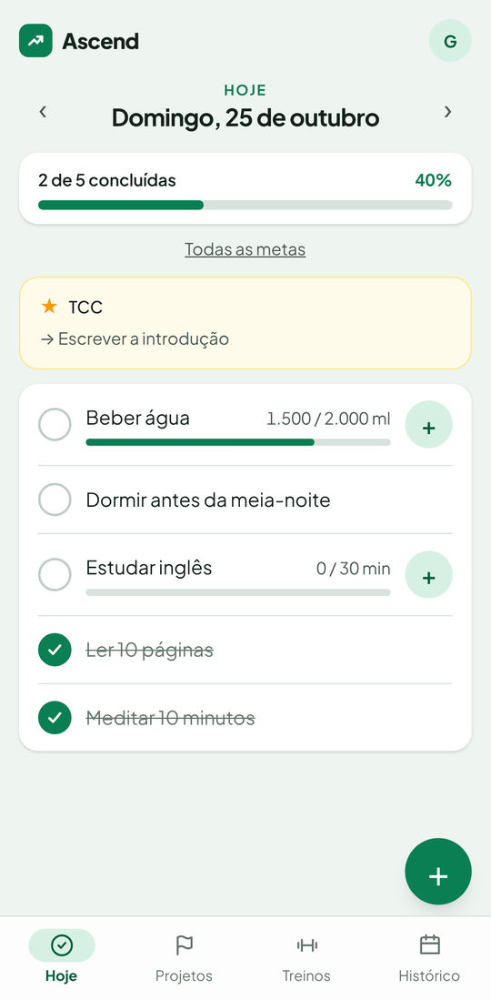
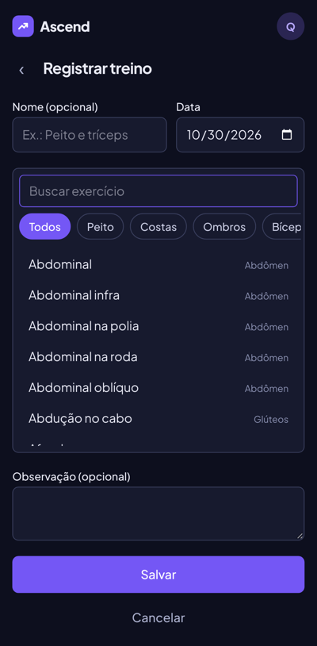
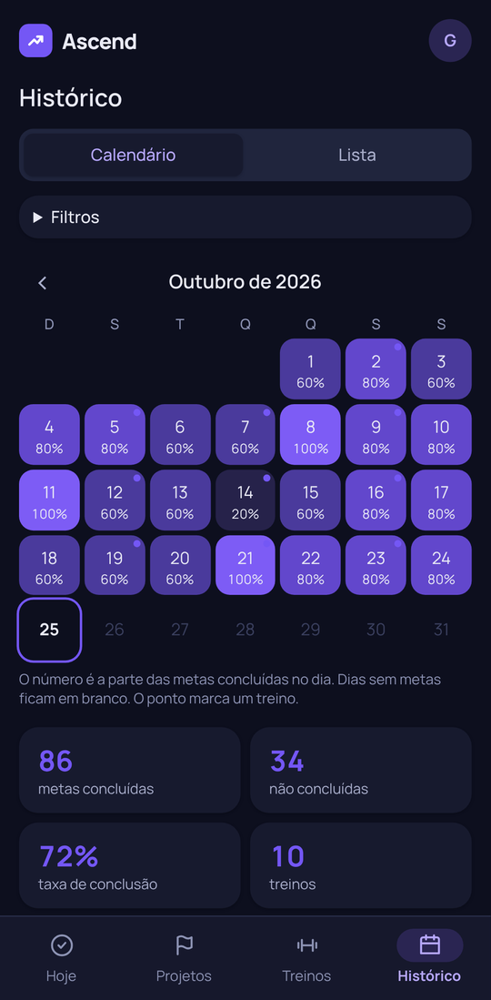

# Ascend

App pessoal para metas diárias, foco em projetos e registro de treinos de musculação. Web, mobile-first, em português.

**No ar:** [ascend-mvp.netlify.app](https://ascend-mvp.netlify.app) (crie uma conta para testar; o primeiro acesso pode levar alguns segundos enquanto o banco acorda).

<p>
  
  
  
</p>

## O que o app faz

- **Hoje:** as metas do dia, binárias (feito/não feito) ou numéricas (ex.: 1.500 de 2.000 ml), com a taxa de conclusão do dia. Dá para navegar para dias passados e futuros.
- **Recorrência:** metas todo dia, em dias da semana escolhidos ou só numa data. Editar, pausar ou excluir vale "só neste dia" ou "deste dia em diante", sem reescrever o passado.
- **Encerramento do dia:** à meia-noite de Brasília o dia fecha sozinho e o que ficou pendente vira "não concluída". Um dia encerrado pode ser corrigido, e a correção fica marcada.
- **Projetos:** um projeto atual em destaque na tela Hoje, com próximo passo e metas ligadas a ele.
- **Treinos:** registro série por série, catálogo com 81 exercícios por grupo muscular, modelos de treino e histórico de cada exercício.
- **Histórico:** calendário com a conclusão de cada dia, lista filtrável e estatísticas básicas.
- **Conta:** cadastro com e-mail e senha, edição dos dados e temas claro e escuro.

## Destaques técnicos

- **Regras de negócio isoladas** em `src/domain`: funções puras, sem banco e sem React, cobertas por testes unitários.
- **Datas sem armadilha de fuso:** datas civis são texto `AAAA-MM-DD` e coluna `date`; "que dia é hoje" é decidido num único lugar, no fuso `America/Sao_Paulo`. Instantes técnicos ficam em UTC.
- **Fechamento preguiçoso e idempotente:** não há cron. Ao abrir o app, os dias vencidos desde a última visita são fechados numa transação, controlados por `usuario.fechado_ate`.
- **Recorrência versionada:** cada mudança de regra cria uma nova versão com vigência, e as ocorrências futuras só vão para o banco quando alguém mexe nelas.
- **Autenticação própria:** senha com Argon2id, sessão em tabela com hash SHA-256 do token e cookie `HttpOnly`. Toda consulta filtra pelo usuário da sessão.
- **Histórico preservado:** chaves estrangeiras com `RESTRICT`/`SET NULL` e arquivamento em vez de exclusão.
- **Qualidade:** TypeScript estrito, 224 testes Vitest (regras e serviços contra um PostgreSQL real), 13 testes ponta a ponta com Playwright e CI no GitHub Actions em toda pull request.

## Stack

Next.js (App Router, Server Components e Server Actions) · TypeScript · PostgreSQL (Neon) · Drizzle ORM · Zod · date-fns · Tailwind CSS · Vitest · Playwright · Netlify

```text
src/app/      rotas (grupos (auth) e (app))
src/domain/   regras puras: datas, recorrência, vigência, fechamento, histórico
src/server/   serviços e Server Actions: transações e checagem de dono
src/db/       schema Drizzle, migrações e conexão
src/ui/       componentes reaproveitáveis
tests/        testes Vitest, espelhando src/
e2e/          testes Playwright
```

## Como foi feito

O produto começou por uma especificação escrita antes do código: requisitos, fluxos, modelo de dados e navegação, todos em [`docs/produto`](docs/produto). Depois veio uma [arquitetura com backlog de 9 entregas](docs/tecnico/arquitetura.md), cada uma numa pull request revisada antes do merge.

O código foi escrito com assistentes de IA (Claude) sob a minha direção: eu concebi o produto, defini os requisitos, tomei as decisões de produto e de arquitetura e revisei e aprovei cada pull request antes do merge.

Documentos principais:

- [Especificação do MVP (v0.4)](docs/produto/Ascend_Documentacao_Produto_MVP_v0.4.md)
- [Fluxos de Hoje e Metas](docs/produto/fluxos-metas.md) e [modelo de dados de Metas](docs/produto/modelo-dados-metas.md)
- [Projetos](docs/produto/projetos.md), [Treinos](docs/produto/treinos.md), [Histórico](docs/produto/historico.md) e [Navegação](docs/produto/navegacao.md)
- [Arquitetura técnica e backlog](docs/tecnico/arquitetura.md)

## Rodando localmente

Pré-requisitos: Node.js 22, pnpm 10 e um PostgreSQL (local ou Neon).

```bash
pnpm install
cp .env.example .env.local   # preencha DATABASE_URL
pnpm db:migrate
pnpm dev                     # http://localhost:3000
```

| Comando | O que faz |
| --- | --- |
| `pnpm test` | Testes Vitest |
| `pnpm test:e2e` | Testes ponta a ponta (Playwright) |
| `pnpm lint` / `pnpm typecheck` | ESLint e TypeScript |
| `pnpm format` | Prettier |
| `pnpm build` | Build de produção |
| `pnpm db:generate` | Gera uma migração a partir de `src/db/schema.ts` |
| `pnpm db:migrate` | Aplica as migrações (em produção roda no deploy) |

Os testes de `tests/server` gravam num PostgreSQL de verdade e só rodam com `DATABASE_URL_TESTE` apontando para um banco local já migrado; sem ela, são pulados:

```bash
DATABASE_URL=postgresql://localhost/ascend_teste pnpm db:migrate
DATABASE_URL_TESTE=postgresql://localhost/ascend_teste pnpm test
```
