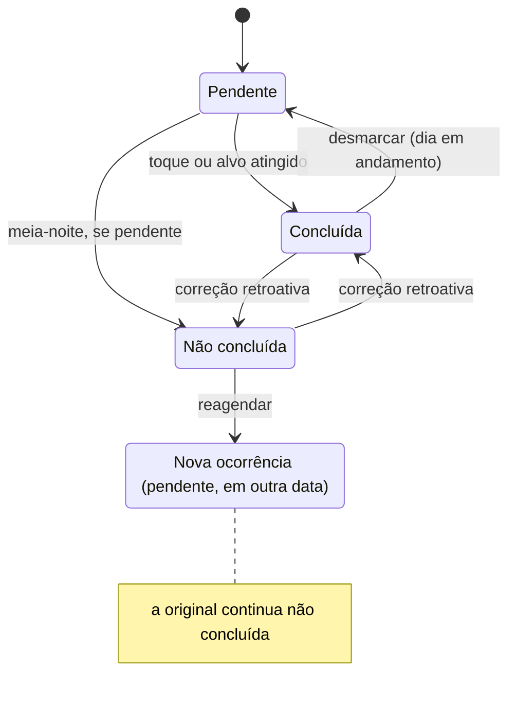

# Ascend – Fluxos de Hoje e Metas

24/10/2026 · gustavo

Este documento define os fluxos da tela Hoje e do módulo de Metas, e as respostas técnicas que eles pedem para a seção 15.3 do [MVP v0.4](Ascend_Documentacao_Produto_MVP_v0.4.md). Nada aqui amplia o escopo. As decisões foram tomadas em 24/10/2026 e estão resumidas no fim do documento.

## Escopo e premissas

- **Base:** MVP v0.4, com o escopo funcional fechado (D-068).
- **Cobre:** tela Hoje, criar e atualizar metas, planejar datas futuras, edição de recorrência, pausa, exclusão, reagendamento, encerramento do dia e correção retroativa.
- **Não cobre:** Projetos, Treinos, Histórico em detalhe, navegação geral e visual. A associação com projeto aparece só como um campo opcional da meta.
- **Vocabulário:** a *meta* é a regra (título, tipo, frequência). A *ocorrência* é a meta em uma data específica, com o estado e o valor daquele dia. A tela Hoje mostra ocorrências.
- **Datas:** tudo usa o fuso fixo `America/Sao_Paulo`. "Hoje" é a data civil nesse fuso.

## Tela Hoje

Hoje é a tela inicial depois do login e responde a uma pergunta: o que falta fazer hoje. Cada meta deve poder ser atualizada ali mesmo, com um toque, sem abrir outra tela (RNF-01).

**Hierarquia (de cima para baixo no celular):**

1. **Cabeçalho:** a data de hoje, setas para o dia anterior e o próximo e um atalho "voltar para hoje" quando o usuário estiver em outra data.
2. **Resumo:** "3 de 5 concluídas", em texto neutro e sem tom de cobrança.
3. **Projeto atual:** uma linha com o nome e o próximo passo, que leva para Projetos. Só aparece se houver projeto atual.
4. **Metas com horário,** em ordem cronológica (RF-MET-14).
5. **Metas sem horário.**
6. **Botão "Nova meta",** sempre visível. A meta já vem com a data que está aberta na tela.

**Linha de uma meta:**

- **Binária:** uma caixa de seleção e o título. Um toque marca como concluída e outro toque desmarca.
- **Numérica:** título, "1,5 / 3 L", uma barra que para em 100% e um botão **+**. O + abre um campo rápido com atalhos de incremento e um campo para digitar o novo total.
- Tocar no título abre o detalhe da ocorrência, com as opções editar, reagendar, pausar e excluir.
- Um selo pequeno indica "reagendada de 12/07" quando a ocorrência veio de um reagendamento.

**Estados da tela:**

| Estado | Quando | O que aparece |
| --- | --- | --- |
| Primeiro acesso | Nenhuma meta criada | Estado vazio com uma frase curta e o botão "Criar primeira meta" (RF-GLO-06) |
| Dia sem metas | Existem metas, mas nenhuma para esta data | "Nada planejado para hoje" e o botão "Nova meta" |
| Dia em andamento | Hoje, com metas | Lista editável |
| Data futura | O usuário navegou para frente | Mesma lista, editando o planejamento. A meta pode ser marcada como concluída antes da data |
| Dia encerrado | Data passada | Lista só para leitura, com o estado final. Um botão "Corrigir" leva para a correção retroativa |

## Criar, atualizar e planejar

Criar uma meta deve levar 3 toques e um título no caso mais comum (binária, diária, sem horário). O resto vem preenchido.

**Criar meta (RF-MET-01 a 05):**

1. Tocar em "Nova meta" em qualquer data.
2. Digitar o título, o único campo obrigatório.
3. Escolher o tipo, **Binária** (padrão) ou **Numérica**. Se for numérica, aparecem os campos de valor-alvo e unidade, ambos obrigatórios.
4. Escolher a frequência: **Só nesta data** (padrão quando a data aberta é futura), **Todo dia** (padrão quando é hoje), **Dias da semana** ou **A cada X dias**.
5. Campos opcionais, recolhidos em "Mais opções": descrição, horário e projeto associado.
6. A data de início é a data que estava aberta, e pode ser trocada.
7. Salvar. A meta aparece na lista da data na posição certa pela ordenação.

Os padrões do passo 4 mudam conforme a data aberta, porque abrir uma data futura para planejar quase sempre significa algo pontual.

**Atualizar meta binária:** um toque alterna entre pendente e concluída, salvando na hora. Não existe um botão "não concluída" durante o dia, porque esse estado só é atribuído no encerramento.

**Atualizar meta numérica (RF-MET-07, 08):**

- O + abre um painel com duas partes. **Somar:** **+1 unidade**, **+ último incremento usado** e um campo para somar outro valor. **Corrigir o total:** um campo que já vem com o valor atual, para trocar um valor digitado errado (ajuste de 24/10/2026, depois do teste no celular).
- O valor pode passar do alvo. A barra para em 100% e o número real continua aparecendo ("3,5 / 3 L").
- Quando chega ao alvo, a ocorrência passa a contar como concluída. Se o valor for corrigido para menos, ela volta a ficar pendente.
- Guarda-se só o valor atual da ocorrência, sem um log de cada incremento. O v0.4 não pede esse histórico.

**Planejar data futura (RF-MET-05):** navegar até a data e usar "Nova meta". A data futura mostra também as ocorrências das recorrências previstas para aquele dia, para dar a visão completa do planejamento.

## Recorrência: editar, pausar e excluir

Toda mudança numa recorrência vale a partir de uma data e nunca toca o passado. Por isso, a regra da meta tem **vigência**: cada versão vale de uma data até outra. Editar "esta e as próximas", pausar, reativar e excluir viram a mesma operação: fechar a versão atual e, quando for o caso, abrir uma nova.

**Editar uma ocorrência recorrente (RF-MET-09):** ao salvar, o sistema pergunta **"Só esta"** ou **"Esta e as próximas"**.

- **Só esta:** a alteração fica gravada só naquela ocorrência, por exemplo outro horário ou outro alvo. A regra não muda.
- **Esta e as próximas:** a versão atual da regra termina no dia anterior e uma nova versão começa na data editada. A meta continua sendo a mesma para o Histórico e para o projeto. Ocorrências futuras que já tinham um ajuste individual ("só esta") mantêm o ajuste.
- Editar uma ocorrência de um dia já encerrado não é edição de recorrência, é correção retroativa (próxima seção). A pergunta não aparece nesse caso.

**Pausar e reativar (RF-MET-10):**

1. No detalhe da meta, "Pausar". A pausa começa hoje. A ocorrência de hoje some se ainda estiver intocada, e fica se já tiver valor ou conclusão.
2. Ocorrências futuras pendentes que já tinham sido ajustadas somem. As futuras concluídas antecipadamente ficam.
3. A meta aparece numa seção "Pausadas", fora da lista do dia.
4. "Reativar" abre uma nova versão a partir de hoje, com a mesma regra. Os dias pausados não geram ocorrências, então não contam como falha nem entram na taxa do calendário.

**Excluir meta recorrente (10.9, RF-HIS-15):** pede confirmação, encerra a regra e esconde a meta das listas. As ocorrências passadas ficam no Histórico. A ocorrência de hoje segue a mesma regra da pausa. Meta de ocorrência única que ainda não aconteceu é apagada de verdade, porque não tem histórico.

**Resumo das operações:**

| Ação | Passado | Hoje | Futuro |
| --- | --- | --- | --- |
| Editar só esta | Intacto | Só a ocorrência editada muda | Intacto |
| Editar esta e as próximas | Intacto | Nova versão vale a partir da data editada | Segue a nova versão; ajustes individuais ficam |
| Pausar | Intacto | Sai se estiver intocada | Nada é gerado; concluídas antecipadas ficam |
| Reativar | Intacto | Volta a ser gerada | Segue a regra |
| Excluir | Preservado no Histórico | Sai se estiver intocada | Nada é gerado |

## Encerramento, reagendamento e correção

Uma ocorrência passa por no máximo três estados, e nenhuma ação apaga uma falha. O reagendamento cria uma ocorrência nova em vez de mover a antiga.

**Encerramento do dia (RF-MET-11, RF-GLO-10):**

- Não existe tarefa agendada para a meia-noite. Antes de qualquer leitura ou alteração (abrir Hoje, abrir o Histórico, login, editar uma ocorrência), o backend roda o **fechamento**: toda ocorrência pendente com data anterior a hoje vira não concluída, com o valor parcial preservado.
- O fechamento é idempotente (13.8): só altera ocorrências ainda pendentes, então rodar duas vezes não muda nada.
- Os dias passados de uma recorrência que o usuário nunca abriu também precisam virar não concluídos. O fechamento gera essas ocorrências faltantes até ontem.
- Se o app estiver aberto na virada da meia-noite, a próxima ação do usuário recarrega o dia, com um aviso discreto "Um novo dia começou", sem bloquear nada.

**Reagendar (RF-MET-13):**

1. Numa ocorrência **não concluída**, tocar em "Reagendar".
2. Escolher a data, com atalhos "Hoje" e "Amanhã" e um calendário.
3. O sistema cria uma ocorrência avulsa na data escolhida, com o mesmo título, tipo e alvo, ligada à original. A nova herda o valor que a original tinha.
4. A original continua não concluída e mostra "reagendada para 15/07". A nova mostra "reagendada de 12/07".

O reagendamento fica disponível só para ocorrências não concluídas. Para adiar uma meta pendente de hoje, o caminho é mudar a data dela ("só esta"), porque ela ainda não falhou.

**Correção retroativa (RF-MET-12, RF-HIS-10, 11):** no dia encerrado, o botão "Corrigir" permite marcar ou desmarcar a conclusão e mudar o valor numérico, sem pedir justificativa. A ocorrência guarda a data e hora da última alteração e uma marca de "alterada após o encerramento", que aparece como selo no Histórico. O calendário recalcula a taxa do dia.

Na tela (entrega 3): o botão "Corrigir" abre a lista do dia em modo de correção, com um aviso e o botão "Pronto". A binária alterna entre concluída e não concluída, porque um dia encerrado não tem pendentes. A numérica recebe o total corrigido, e o alvo decide se ela foi concluída. Cada mudança salva na hora, e a linha passa a mostrar o selo "Corrigida" também na lista do dia, não só no Histórico.

## Respostas para a 15.3

A principal decisão é **materializar ocorrências só quando necessário**. Datas futuras são calculadas a partir da regra, e a ocorrência só vira linha no banco quando o dia chega ou quando o usuário mexe nela. O detalhe está em [modelo-dados-metas.md](modelo-dados-metas.md).

| Questão da 15.3 | Resposta |
| --- | --- |
| Materialização das ocorrências | Híbrida e preguiçosa. Uma data é materializada quando vira hoje, quando o fechamento passa por ela ou quando o usuário altera uma ocorrência futura. Antes disso, ela é calculada a partir da regra vigente |
| Recorrência editada com datas futuras já materializadas | Só existem no futuro as ocorrências que o usuário mexeu de propósito. Em "esta e as próximas", os ajustes delas são mantidos |
| Evitar duplicatas e garantir idempotência | Chave única (meta, data prevista) para ocorrências geradas pela regra. Ocorrências reagendadas ficam fora dessa chave e apontam para a original |
| Guardar mudanças de projeto atual | Tabela simples de trocas (usuário, projeto ou nenhum, data civil, instante UTC). O foco de uma data é a última troca até aquele dia |
| Método de sessão | Sessão no servidor com cookie `HttpOnly`, `Secure` e `SameSite=Lax` |
| Unicidade e troca de e-mail | E-mail único sem diferenciar maiúsculas. Trocar e-mail ou senha exige a senha atual |
| Transações | Reagendar, excluir meta e trocar projeto atual rodam numa transação cada |

## Decisões de 24/10/2026

| # | Questão | Decisão |
| --- | --- | --- |
| 1 | Frequência padrão ao criar | "Todo dia" quando a data aberta é hoje; "Só nesta data" quando é futura |
| 2 | Concluir em data futura | Permitido: a meta pode ser concluída antes da data planejada |
| 3 | Pausar ou excluir com progresso hoje | Pausar mantém a ocorrência de hoje se tiver progresso. Excluir segue o v0.4: para o futuro e preserva o passado |
| 4 | Log de incrementos | Não, por enquanto só o valor atual |
| 5 | Valor da reagendada | Herda o valor que a original tinha |
| 6 | Reagendar vs. mudar a data | Reagendar só para não concluídas. Uma pendente de hoje é adiada mudando a data ("só esta"), sem registrar falha |
| 7 | "Esta e as próximas" com ajustes individuais | Os ajustes individuais são mantidos |
| 8 | Futuras ao pausar | Pendentes já ajustadas são apagadas; concluídas antecipadamente são mantidas |

## Detalhes definidos na entrega 4 (25/10/2026)

Pontos que os fluxos acima não fechavam e que a entrega 4 precisou decidir. Todos podem ser revistos na revisão da PR.

| # | Situação | Como ficou |
| --- | --- | --- |
| 9 | Tocar numa meta da lista | A bolinha marca e desmarca. O título abre o detalhe, com editar, mudar a data, reagendar, pausar e excluir |
| 10 | O que "só esta" muda | Título, horário e alvo. Descrição e frequência são da regra e só mudam em "esta e as próximas". Tirar o horário de uma só ocorrência também não dá: isso é feito em "esta e as próximas" |
| 11 | Ocorrência editada com "esta e as próximas" | Ela segue a regra nova e perde os ajustes que tinha, porque a tela mostrou os valores dela e você os salvou como a regra |
| 12 | Nova regra que não cai mais numa data já mexida | Ocorrência futura intocada some. Se já tiver valor ou conclusão, fica |
| 13 | Recorrente vira "Só nesta data"? | Não. Para encerrar uma recorrente existem Pausar e Excluir. Uma meta de ocorrência única pode virar recorrente |
| 14 | Editar a partir de Todas as metas | Vale de hoje em diante (ou da data de início, se a meta ainda não começou), sem a pergunta |
| 15 | Pausar meta de ocorrência única | Não aparece: pausar é só para recorrentes |
| 16 | Excluir e o futuro | O futuro todo sai, inclusive o que foi concluído antes da data. Uma meta que fica sem nenhuma ocorrência gravada não tem história e é apagada de verdade |
| 17 | Reagendar duas vezes | Cada não concluída é reagendada uma vez. Se a nova também falhar, ela pode ser reagendada |
| 18 | Mudar a data | Vale para pendentes de hoje e do futuro, inclusive reagendadas. Com atalhos "Hoje" e "Amanhã" e um calendário, como no reagendamento |
| 19 | Reativar no mesmo dia da pausa | A regra volta como estava, sem versão nova. Depois de dias pausados, nasce uma versão nova a partir de hoje |

## Revisão das metas (25/10/2026)

| # | Situação | Como ficou |
| --- | --- | --- |
| 20 | Reativar uma meta que tinha uma mudança agendada ("esta e as próximas" numa data futura) | A regra de antes volta a valer de hoje até a véspera da mudança, e a mudança segue agendada. Antes da correção, os dias entre hoje e a mudança sumiam |
