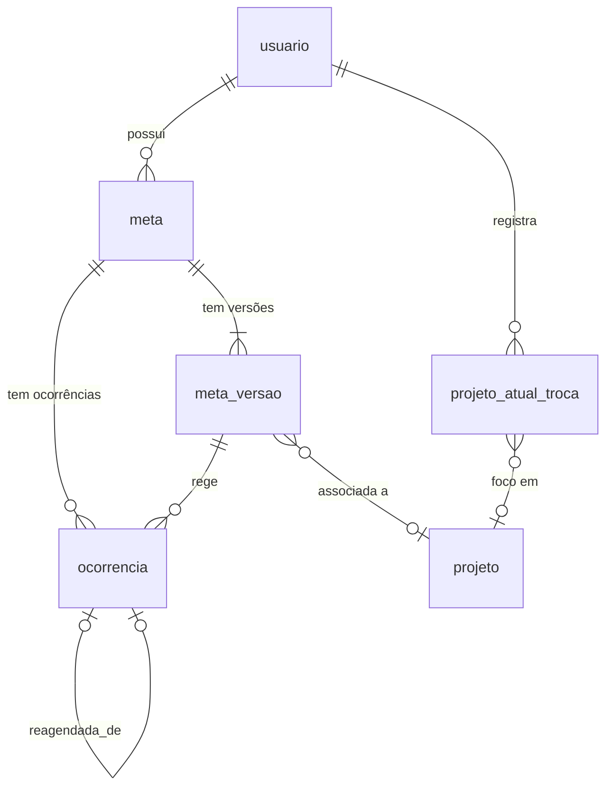

# Ascend – Modelo de dados de Metas

24/10/2026 · gustavo

O modelo de Metas tem três tabelas centrais: `meta` (a identidade), `meta_versao` (a regra, com vigência) e `ocorrencia` (o que aconteceu em cada data). As ocorrências futuras são calculadas a partir da regra e só vão para o banco quando alguém mexe nelas ou quando o dia passa. O modelo segue as decisões de [fluxos-metas.md](fluxos-metas.md) e o [MVP v0.4](Ascend_Documentacao_Produto_MVP_v0.4.md). Banco escolhido: **PostgreSQL**.

## Visão geral

Todas as tabelas pertencem a um usuário. Uma meta tem várias versões e várias ocorrências, e cada ocorrência aponta para a versão que a rege. Uma ocorrência reagendada aponta para a original.

## Tabelas

Todo `id` é UUID, todo `*_em` é `timestamptz` em UTC e todo `data*` é `date` civil sem fuso (D-063, D-064).

### meta

A identidade da meta. Guarda só o que nunca muda ao longo da vida dela.

| Coluna | Tipo | Regra |
| --- | --- | --- |
| id | uuid | PK |
| usuario_id | uuid | FK usuario, obrigatório (13.6) |
| tipo | enum `binaria`, `numerica` | Imutável |
| unidade | text | Obrigatória se for numérica, nula se for binária. Imutável |
| estado | enum `ativa`, `pausada`, `excluida` | |
| criado_em, atualizado_em, excluida_em | timestamptz | |

Tipo e unidade são imutáveis: para trocar uma meta de binária para numérica, cria-se outra meta. Isso evita um Histórico com dias de tipos misturados.

### meta_versao

A regra da meta com vigência. Cada "esta e as próximas", pausa ou reativação fecha uma versão e, quando for o caso, abre outra.

| Coluna | Tipo | Regra |
| --- | --- | --- |
| id | uuid | PK |
| meta_id | uuid | FK meta |
| vigente_de | date | Obrigatório |
| vigente_ate | date | Nulo enquanto estiver aberta. As versões de uma meta não se sobrepõem. Pode ser `vigente_de − 1` (versão vazia): uma regra que ainda não tinha começado quando a meta foi pausada ou excluída |
| titulo | text | Obrigatório |
| descricao | text | Opcional |
| horario | time | Opcional, hora local de São Paulo |
| valor_alvo | numeric | Obrigatório se for numérica |
| frequencia | enum `unica`, `diaria`, `semanal`, `intervalo` | |
| dias_semana | smallint[] | Só em `semanal`, de 0 a 6 |
| intervalo_dias | int | Só em `intervalo`, maior ou igual a 2 |
| projeto_id | uuid | FK projeto, opcional, `ON DELETE SET NULL` (8.8) |
| criado_em | timestamptz | |

O projeto fica na versão, e não na meta. Assim, trocar o projeto com "esta e as próximas" não muda qual projeto aparece nos dias passados do Histórico.

### ocorrencia

A meta em uma data, com o que de fato aconteceu. É a fonte do Histórico e das estatísticas (13.9).

| Coluna | Tipo | Regra |
| --- | --- | --- |
| id | uuid | PK |
| usuario_id | uuid | FK usuario, repetido aqui para filtrar por dono sem join |
| meta_id | uuid | FK meta |
| versao_id | uuid | FK meta_versao, a regra que gerou ou rege esta ocorrência |
| origem | enum `regra`, `reagendada` | |
| data_prevista | date | A vaga da regra. Preenchida só se `origem = regra` |
| data | date | A data efetiva em que aparece. Muda quando uma pendente é adiada |
| reagendada_de_id | uuid | FK ocorrencia, preenchida só se `origem = reagendada` |
| estado | enum `pendente`, `concluida`, `nao_concluida` | |
| valor_atual | numeric | Só em numérica, começa em 0 ou herda da original |
| titulo, horario, valor_alvo | colunas de ajuste | Nulas, a não ser que haja um "só esta". Quando preenchidas, prevalecem sobre a versão |
| concluida_em, encerrada_em | timestamptz | `encerrada_em` é preenchido pelo fechamento do dia |
| corrigida_apos_encerramento | boolean | RF-MET-12 |
| criado_em, atualizado_em | timestamptz | |

A restrição principal é `UNIQUE (meta_id, data_prevista) WHERE origem = 'regra'`. Ela impede duplicatas e torna a geração idempotente (13.8): inserir a mesma vaga duas vezes não cria nada. Outra, `UNIQUE (reagendada_de_id)`, garante que cada ocorrência seja reagendada uma vez só.

### Tabelas de apoio

| Tabela | Colunas principais | Para quê |
| --- | --- | --- |
| usuario | id, nome, email (único sem diferenciar maiúsculas), senha_hash, fechado_ate (date) | Dono de tudo. `fechado_ate` diz até que dia o fechamento já rodou |
| sessao | id, usuario_id, token_hash, criado_em, expira_em | Sessão no servidor com cookie |
| projeto_atual_troca | id, usuario_id, projeto_id (nulo = nenhum), data, criado_em | O foco de uma data é a última troca com `data` menor ou igual a ela (RF-HIS-09) |

A tabela `projeto` fica para o modelo de Projetos.

## Operações

Cada fluxo vira poucas escritas, e todas cabem numa transação. O ponto central é a regra de leitura de uma data, que combina ocorrências gravadas com ocorrências calculadas.

**Ler a lista de uma data D (tela Hoje, data futura, Histórico):**

1. Rodar o fechamento, se `usuario.fechado_ate` for anterior a ontem.
2. Buscar as ocorrências gravadas com `data = D`.
3. Calcular as vagas virtuais: para cada versão vigente em D de uma meta `ativa`, verificar se a frequência cai em D. Descartar as vagas que já têm ocorrência gravada com `data_prevista = D`, mesmo que essa ocorrência tenha sido adiada para outra data.
4. Unir, aplicar os ajustes de "só esta" e ordenar: primeiro as que têm horário, depois as sem horário (RF-MET-14).

Uma vaga virtual só é gravada quando alguém mexe nela. A regra de `intervalo` conta a partir de `vigente_de` da versão, então a contagem recomeça ao reativar.

**Fechamento do dia (preguiçoso e idempotente):**

1. Para cada versão com vigência entre `fechado_ate + 1` e ontem, inserir as vagas que faltam como `nao_concluida`, com `ON CONFLICT DO NOTHING`.
2. `UPDATE ocorrencia SET estado = 'nao_concluida', encerrada_em = now() WHERE estado = 'pendente' AND data < hoje`. As já concluídas recebem só `encerrada_em`.
3. `fechado_ate = ontem`. Rodar de novo não muda nada.

**Os fluxos:**

| Fluxo | O que grava |
| --- | --- |
| Criar meta | 1 `meta` e 1 `meta_versao` com `vigente_de` igual à data aberta. Nenhuma ocorrência, porque a lista as calcula |
| Marcar ou somar valor | Grava a vaga (se ainda for virtual) e atualiza `estado` e `valor_atual`. Vale também para datas futuras |
| Editar "só esta" | Grava a vaga e preenche as colunas de ajuste |
| Adiar uma pendente de hoje | Grava a vaga e muda `data`. `data_prevista` continua a original |
| Editar "esta e as próximas" a partir de D | Fecha a versão em D − 1 e abre uma nova em D. As ocorrências gravadas de D em diante sem ajustes passam para a nova versão. As que têm ajuste ficam como estão |
| Pausar | Fecha a versão ontem, ou hoje se a ocorrência de hoje tiver progresso. Futuras pendentes gravadas são apagadas e futuras concluídas são mantidas. `estado = pausada` |
| Reativar | Abre uma versão nova a partir de hoje, copiando a última. `estado = ativa` |
| Excluir | Igual a pausar, com `estado = excluida` e sem reativação. O passado fica (v0.4, D-054) |
| Reagendar uma não concluída | Insere uma `ocorrencia` com `origem = reagendada`, `reagendada_de_id` apontando para a original e o mesmo `valor_atual` |
| Corrigir dia encerrado | Atualiza `estado` e `valor_atual` e marca `corrigida_apos_encerramento = true` |
| Trocar projeto atual | Insere 1 `projeto_atual_troca` com a data de hoje |

**Calendário e estatísticas (10.3, 10.10):** a taxa de um dia é o número de concluídas dividido pelo total de ocorrências com `data` naquele dia. Um dia sem ocorrências é neutro. Para dias passados, tudo já está gravado por causa do fechamento, então basta um `GROUP BY data`.
