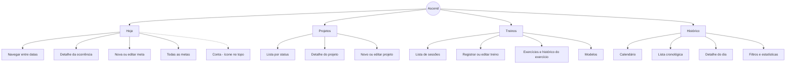

# Ascend – Navegação

24/10/2026 · gustavo

O app tem quatro áreas fixas: **Hoje, Projetos, Treinos e Histórico**. Ele sempre abre em Hoje, e qualquer ação do dia a dia fica a no máximo dois toques de distância. Este documento responde à seção 15.1 do [MVP v0.4](Ascend_Documentacao_Produto_MVP_v0.4.md) e usa as telas definidas em [Metas](fluxos-metas.md), [Projetos](projetos.md) e [Treinos](treinos.md).

## Mapa

Hoje é a tela inicial e a mais usada. Metas não têm área própria: tudo sobre elas começa em Hoje.

## Telas e endereços

Cada tela tem um endereço próprio. Assim, o botão voltar do navegador funciona e dá para salvar atalhos, como `/hoje` na tela inicial do celular. Datas no endereço usam o formato `AAAA-MM-DD`.

| Área | Endereço | Tela | Ação principal |
| --- | --- | --- | --- |
| Acesso | `/entrar`, `/cadastro` | Login e cadastro | Entrar |
| Hoje | `/hoje` | Lista do dia atual | + Nova meta |
| Hoje | `/dia/2026-10-25` | Mesma lista em outra data, para planejar ou consultar | + Nova meta |
| Hoje | `/dia/2026-10-20?corrigir=1` | Correção de um dia encerrado | Pronto |
| Hoje | `/metas/novo`, `/metas/:id` | Criar meta, ou detalhe com editar, pausar e excluir | Salvar |
| Hoje | `/metas` | Todas as metas: ativas, pausadas e de ocorrência única futura | Reativar |
| Projetos | `/projetos` | Lista por status, com o atual no topo | + Novo projeto |
| Projetos | `/projetos/novo`, `/projetos/:id` | Criar ou ver e editar projeto | Salvar |
| Treinos | `/treinos` | Lista de sessões | + Registrar treino |
| Treinos | `/treinos/novo`, `/treinos/:id` | Registrar, ver ou editar sessão | Salvar |
| Treinos | `/exercicios`, `/exercicios/:id` | Catálogo e histórico de um exercício | + Novo exercício |
| Treinos | `/modelos`, `/modelos/:id` | Lista e edição de modelos | + Novo modelo |
| Histórico | `/historico` | Calendário do mês, com a taxa por dia | Filtros |
| Histórico | `/historico/lista` | Lista cronológica agrupada por data | Filtros |
| Histórico | `/historico/2026-07-10` | Detalhe do dia, com o botão Corrigir | Corrigir |
| Conta | `/conta` | Nome, e-mail, senha e sair (11.6) | Salvar |

**Dia passado em Hoje ou no Histórico?** Navegar para trás em Hoje leva a `/dia/...` de um dia encerrado, que mostra a lista só para leitura com o botão Corrigir. O detalhe do dia no Histórico mostra mais coisas: projeto em foco, treino do dia e selos de correção. Os dois caminhos levam à mesma correção: o botão Corrigir abre a lista do dia em modo de correção (`?corrigir=1`), onde cada mudança salva na hora e ganha o selo "Corrigida".

**Atalhos entre áreas:** o projeto atual em Hoje leva para `/projetos/:id`. O treino no detalhe do dia leva para `/treinos/:id`. Um exercício dentro de um treino leva para `/exercicios/:id`. Não existe atalho de Hoje para registrar treino, porque treino e meta são independentes (9.12).

## Celular e computador

As áreas e os endereços são os mesmos nos dois. O que muda é onde fica o menu e quanto cabe na tela.

| | Celular (mobile-first) | Computador |
| --- | --- | --- |
| Menu das 4 áreas | Barra fixa embaixo, com ícone e nome | Barra lateral fixa à esquerda |
| Conta | Ícone no canto superior direito | Item no fim da barra lateral |
| Ação principal | Botão redondo flutuante acima da barra | Botão no topo da tela |
| Formulários (meta, projeto) | Tela cheia, com voltar no topo | Painel lateral sobre a lista, que continua visível |
| Registro de treino | Tela cheia | Tela cheia, com largura limitada para não esticar as linhas |
| Histórico | Calendário em cima e o detalhe do dia abre por cima | Calendário e detalhe do dia lado a lado |

No celular, a barra inferior some só dentro de formulários, para dar espaço ao teclado.

## Decisões de 24/10/2026

| # | Pergunta | Decisão |
| --- | --- | --- |
| 1 | Áreas fixas do menu | Hoje, Projetos, Treinos e Histórico |
| 2 | Metas têm área própria? | Não; vivem em Hoje, com o link "Todas as metas" no topo |
| 3 | Onde fica a Conta? | No ícone do canto superior, fora da barra |
| 4 | Onde o app abre? | Sempre em Hoje, na data atual |
| 5 | Exercícios e Modelos têm área própria? | Não; são abas dentro de Treinos |
| 6 | Botão flutuante por área | Hoje: Nova meta. Projetos: Novo projeto. Treinos: Registrar treino. Histórico: nenhum |

## Decisões da entrega 8 (25/10/2026)

| # | Pergunta | Decisão |
| --- | --- | --- |
| 7 | Formulários no computador | Abrem na própria tela, numa coluna mais estreita, com a barra lateral à vista, em vez do painel lateral sobre a lista. O painel exigiria telas sobrepostas em todos os formulários de meta e projeto, e o ganho para um usuário só é pequeno |
| 8 | A partir de que largura vale o layout de computador | 768 px (tablet deitado e computador) |
| 9 | Conta: o que pede a senha atual | Trocar e-mail e trocar senha. Nome não pede |
| 10 | Trocar a senha e os outros aparelhos | Os outros aparelhos saem e precisam entrar com a senha nova; este continua dentro |
