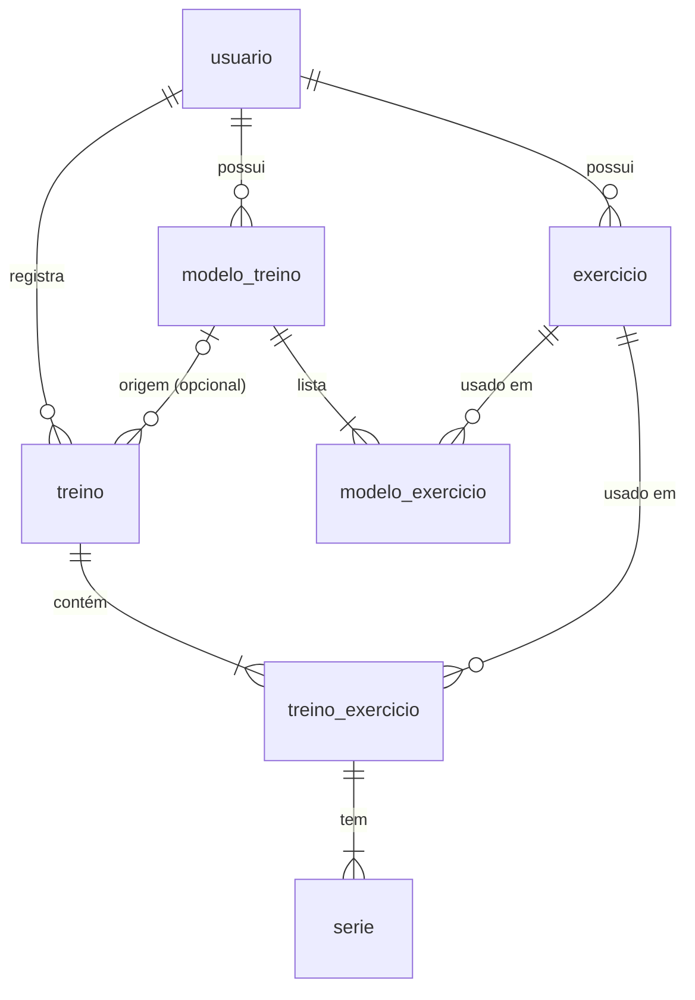

# Ascend – Treinos: fluxos e modelo

24/10/2026 · gustavo

Treinos registra sessões de musculação depois de acontecerem, série por série, com catálogo de exercícios e modelos que servem só de ponto de partida (seções 9.1 a 9.15 do [MVP v0.4](Ascend_Documentacao_Produto_MVP_v0.4.md)). Este documento define os fluxos e as seis tabelas do módulo. As decisões que o v0.4 deixava em aberto foram tomadas em 24/10/2026 e estão no fim.

## Fluxos

**Tela Treinos:** a lista de sessões, da mais recente para a mais antiga ("10/07 · Peito e tríceps"), e um botão **Registrar treino**. Duas abas secundárias dão acesso a **Exercícios** e **Modelos**.

**Registrar treino (RF-TRE-08 a 14):**

1. "Registrar treino" e escolher entre **A partir de um modelo** (lista de modelos) e **Treino livre**.
2. Cabeçalho: nome, que é opcional e vem com o nome do modelo quando houver, e data, que vem como hoje.
3. Cada exercício é um bloco com suas séries em linhas: **repetições** (obrigatório), **carga em kg** (opcional) e **observação** (opcional, recolhida).
4. "+ Série" adiciona uma linha copiando a carga e as repetições da anterior. Cada série pode ser removida ou subir e descer.
5. "+ Exercício" abre uma busca no catálogo. Os exercícios parecidos aparecem enquanto você digita. Se nada servir, a última opção é **Criar "Supino inclinado"**, que cria o exercício e já o adiciona, sem sair do registro (RF-TRE-03).
6. Exercícios podem ser removidos ou subir e descer.
7. Observação geral da sessão, opcional.
8. **Salvar** grava tudo de uma vez (9.9). Sair com alterações não salvas pede confirmação.

**A partir de um modelo:** o formulário já vem com os exercícios do modelo, na ordem, e com a quantidade sugerida de séries em branco. A faixa de repetições aparece como dica dentro do campo ("8–12"), sem preencher o valor. Daqui em diante, a sessão é independente do modelo (D-033, D-034).

**Ao salvar:** séries sem repetições são descartadas, e exercícios sem nenhuma série também. Um aviso diz quantas foram descartadas. Assim, um modelo com 4 séries sugeridas em que você fez só 3 não dá erro.

**Detalhe, edição e exclusão (RF-TRE-15, 17, 18):** tocar numa sessão abre o detalhe completo. "Editar" abre o mesmo formulário do registro. "Excluir" pede confirmação e não mexe no catálogo de exercícios. Pode haver mais de uma sessão no mesmo dia.

**Histórico por exercício (RF-TRE-16):** pelo catálogo, ou tocando no nome de um exercício dentro de uma sessão. Mostra uma linha por sessão, da mais recente para a mais antiga: "10/07 · 40×10, 40×9, 38×8". Exercícios com peso corporal aparecem como "×10, ×10, ×8".

**Catálogo de exercícios (RF-TRE-01 a 05):**

- Uma lista com busca e o botão "Novo exercício". O único campo é o nome.
- Nomes iguais ignorando maiúsculas, acentos e espaços extras são bloqueados ("supino  reto" = "Supino Reto"). Nomes parecidos são só sugeridos, não bloqueados ("Supino" e "Supino reto" podem coexistir). Isso responde à 15.3 sobre normalização.
- Renomear um exercício muda o nome em todos os treinos, porque é o mesmo exercício. Para uma variação de verdade, cria-se outro exercício.
- **Excluir** só aparece para exercícios nunca usados. Para os usados, a opção é **Arquivar**: o exercício some da busca, mas continua nas sessões antigas e no seu histórico.
- Um filtro "Mostrar arquivados" lista os arquivados, que podem ser desarquivados.

**Modelos (RF-TRE-06, 07):** criar, editar e excluir. Um modelo tem nome, observação e uma lista ordenada de exercícios, cada um com séries sugeridas e faixa de repetições (mínimo e máximo, sendo o máximo opcional). Não há carga (D-032). Editar ou excluir um modelo não muda nenhuma sessão já registrada (D-045).

## Modelo de dados

São seis tabelas, com as mesmas convenções de Metas: UUID, datas civis em `date` e instantes em UTC. A sessão é uma cópia do modelo, então nada liga as séries de um treino ao modelo depois que o treino é salvo. A tabela de sessão se chama `treino` para não confundir com a `sessao` de login.

| Tabela | Colunas | Regras |
| --- | --- | --- |
| exercicio | id, usuario_id, nome, nome_normalizado, arquivado_em, criado_em | `UNIQUE (usuario_id, nome_normalizado)`. `nome_normalizado` = minúsculas, sem acentos, espaços simples |
| modelo_treino | id, usuario_id, nome, observacao, criado_em, atualizado_em | |
| modelo_exercicio | id, modelo_id, exercicio_id, ordem, series_sugeridas, reps_min, reps_max | `series_sugeridas >= 1`. `reps_max` opcional e maior ou igual a `reps_min`. Apagado junto com o modelo |
| treino | id, usuario_id, nome, data, observacao, modelo_id, criado_em, atualizado_em | `data` é data civil. `modelo_id` é só informativo, com `ON DELETE SET NULL` |
| treino_exercicio | id, treino_id, exercicio_id, ordem | Apagado junto com o treino |
| serie | id, treino_exercicio_id, ordem, repeticoes, carga_kg, observacao | `repeticoes > 0` obrigatório. `carga_kg` opcional, `numeric(6,2)`, maior ou igual a 0. Apagada junto com o exercício do treino |

**Proteção do histórico:** as referências a `exercicio` em `modelo_exercicio` e `treino_exercicio` usam `ON DELETE RESTRICT`. O banco impede apagar um exercício usado, e o app oferece arquivar no lugar (D-044). Excluir um treino apaga suas séries em cascata, mas nunca o exercício.

**Operações:**

| Fluxo | O que grava |
| --- | --- |
| Salvar treino novo | 1 `treino`, os `treino_exercicio` e as `serie`, numa transação, já sem as séries vazias |
| Editar treino | Substitui os exercícios e as séries do treino pelo conteúdo do formulário, numa transação. O MVP não exige auditoria (9.11) |
| Iniciar pelo modelo | Nada é gravado até salvar. O formulário é montado a partir de `modelo_exercicio` |
| Histórico por exercício | `serie` → `treino_exercicio` → `treino`, filtrando por `exercicio_id` e ordenando por `treino.data` decrescente e depois por `ordem` |
| Arquivar ou desarquivar | Preenche ou limpa `arquivado_em` |
| Histórico do dia | Treinos com `treino.data = D`, para o detalhe do dia e para a contagem de treinos (RF-HIS-07, 14) |

## Decisões de 24/10/2026

| # | Pergunta | Decisão |
| --- | --- | --- |
| 1 | "+ Série" copia a anterior? | Sim, carga e repetições |
| 2 | O modelo preenche as repetições? | Não; a faixa aparece só como dica |
| 3 | Séries vazias ao salvar | Descartadas, com aviso |
| 4 | Renomear exercício muda os treinos antigos? | Sim. A regra 13.1 vale para os dados do treino (séries, cargas, repetições), não para o nome |
| 5 | Exercícios duplicados | Bloqueia nomes iguais ignorando maiúsculas, acentos e espaços; só sugere os parecidos |
| 6 | Exercício arquivado pode voltar? | Sim |
| 7 | Dois treinos no mesmo dia? | Sim |
| 8 | Excluir modelo afeta treinos feitos com ele? | Não; eles só perdem a referência |

## Detalhes da implementação (entrega 6, 25/10/2026)

Pontos que a especificação deixava em aberto e foram resolvidos ao construir, sem mudar o escopo:

| # | Situação | Como ficou |
| --- | --- | --- |
| 9 | Data do treino no futuro | Não é aceita: o treino é registrado depois de acontecer (9.9) |
| 10 | Salvar sem nenhuma série com repetições | Não salva e pede pelo menos uma série |
| 11 | Criar no registro um nome que já existe arquivado | Usa o exercício existente e o desarquiva, em vez de dar erro |
| 12 | Modelo sem exercícios | Não é aceito; o máximo de repetições igual ao mínimo vira "só o mínimo" |
| 13 | Onde fica o "Novo exercício" | No catálogo, usando a mesma busca do registro: os parecidos aparecem antes de criar |
| 14 | Editar treino muda o modelo de origem? | Não; a referência ao modelo fica como no registro |
| 15 | Título de um treino sem nome | Os nomes dos exercícios, na ordem ("Supino reto, Flexão") |
| 16 | Catálogo vazio no primeiro acesso? | Não: toda conta começa com cerca de 35 exercícios comuns (supino, agachamento, rosca…), que se renomeiam, arquivam ou excluem como os outros. Pedido em 25/10/2026 |
